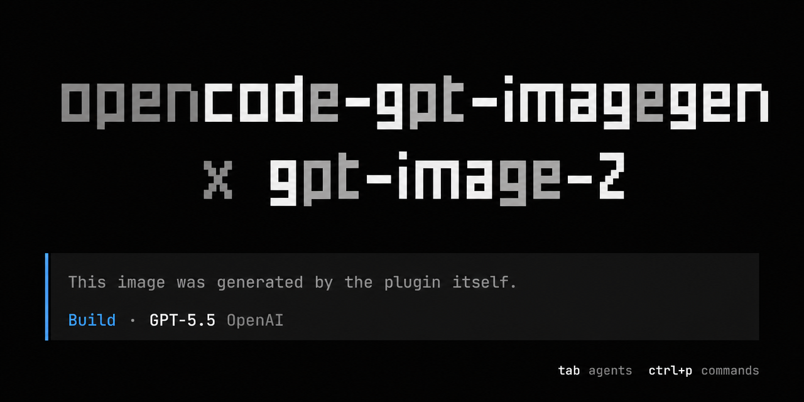

# opencode-gpt-imagegen

> **⚠️ Plugin versions before `0.1.13` no longer generate images.** [GPT-5.5 retired from Codex with ChatGPT sign-in](https://learn.chatgpt.com/docs/models#gpt-55-retirement) on October 14, 2026, and those versions use it. Follow the [update steps](#updating-the-plugin) to install the latest version.

> **📣 `1.0.0` changes how `gpt_imagegen` is used.** `size` now accepts only seven fixed sizes, and `quality` is removed. See the [release notes](https://github.com/yuji-hatakeyama/opencode-gpt-imagegen/releases/tag/v1.0.0) for all changes.

> **📣 OpenAI API key support is on hold.** This plugin uses Codex OAuth with a ChatGPT subscription. If you need API key support, please share your use case in [#120](https://github.com/yuji-hatakeyama/opencode-gpt-imagegen/issues/120).

<p align="center"></p>

> Bring [**ChatGPT Images 2.0**](https://openai.com/index/introducing-chatgpt-images-2-0/) (`gpt-image-2`) to [OpenCode](https://opencode.ai). Use it through your **ChatGPT subscription** (no API costs!).

[](https://opencode.ai/docs/plugins/)
[](https://www.npmjs.com/package/opencode-gpt-imagegen)
[](https://github.com/yuji-hatakeyama/opencode-gpt-imagegen/actions/workflows/ci.yml)
[](./LICENSE)

## Highlights

- **Subscription-friendly.** Generations ride on the same Codex backend channel OpenCode already uses for ChatGPT subscription chat — billed against your existing ChatGPT Plus, Pro, or Business plan, not your API credits.
- **Reference images.** Pass up to five input images alongside the prompt for style guidance, edit targets, or compositing inputs.
- **Transparent backgrounds.** Ask for a transparent background, a cutout, or background removal, and the agent passes `background: "transparent"` to get an RGBA PNG. The cutout edges can be rough, with a faint semi-transparent halo. For a clean cutout, generate the image on a plain background and remove the background yourself.

## Installation

The same package supports OpenCode V1 (1.18.29 or newer) and V2 (2.0.0 or newer).

For V2, add this plugin to your [OpenCode config](https://opencode.ai/v2/docs/plugins/):

```json
{
  "$schema": "https://opencode.ai/config.json",
  "plugins": ["opencode-gpt-imagegen"]
}
```

For V1, use the singular `plugin` field:

```json
{
  "$schema": "https://opencode.ai/config.json",
  "plugin": ["opencode-gpt-imagegen"]
}
```

OpenCode installs the package automatically. Unless you use a proxy, sign in to OpenAI with Codex OAuth. On V2, run `/connect`, select OpenAI, and choose **Codex browser (legacy)** or **Codex device code (legacy)**. The **Sign in with ChatGPT** option uses token sharing, which [does not support image generation](https://developers.openai.com/siwc/token-sharing-open-source/preview-limitations).

V2 uses the currently active OpenAI connection and lets OpenCode refresh its token. It does not fall back to V1's `auth.json` or the Codex CLI's credentials. V1 retains its existing ChatGPT OAuth setup.

### Sending requests through a proxy

Set `baseURL` if you reach ChatGPT through a gateway rather than signing OpenCode in to ChatGPT yourself, for example a local proxy that holds one or more ChatGPT sign-ins and spreads requests across them. In that setup OpenCode's `auth.json` usually has no ChatGPT sign-in, and calling chatgpt.com directly would bypass the gateway.

On V2, pass options with the package object:

```json
{
  "plugins": [{ "package": "opencode-gpt-imagegen", "options": { "baseURL": "http://127.0.0.1:3457/v1" } }]
}
```

On V1, use the package-and-options tuple:

```json
{
  "plugin": [["opencode-gpt-imagegen", { "baseURL": "http://127.0.0.1:3457/v1" }]]
}
```

With `baseURL` set, the plugin skips authentication lookup and sends the proxy no credentials on both versions. It sends the same requests it would send to ChatGPT, to `<baseURL>/images/generations`, or to `<baseURL>/images/edits` when reference images are given. Your proxy works with this option if it:
- accepts those two `POST` routes without an `Authorization` header;
- forwards the JSON body unchanged to the Codex images endpoints (`https://chatgpt.com/backend-api/codex/images/generations` and `/edits`), signed in with a ChatGPT account. The body has `prompt`, `model`, `quality`, `size` and `background`, plus `images` (a list of `{ "image_url": "data:..." }`) for edits;
- answers with the backend's JSON, in which `data[0].b64_json` holds the PNG. Any non-2xx status is reported as an error together with the start of the response body.

The request takes as long as the backend needs to draw the image, often 30 seconds or more, so the proxy must not time it out early.

### Updating the plugin

On V2, update an unpinned package with `opencode plugin update opencode-gpt-imagegen`. If you pinned an exact version, update that version in your configuration. See [OpenCode's plugin management guide](https://opencode.ai/v2/docs/plugins/#manage).

On V1, OpenCode caches npm plugins, so restarting it may keep an older version. To update this plugin:
1. Check the `plugin` entry in your OpenCode config. Use `"opencode-gpt-imagegen"` or `"opencode-gpt-imagegen@latest"` to request the latest version. If you pinned a version, remove the version suffix or change it to the version you want to install.
2. Quit OpenCode completely.
3. If your entry is unversioned or uses `@latest`, delete the cached directory `~/.cache/opencode/packages/opencode-gpt-imagegen@latest/`.
4. Restart OpenCode to install the requested version.

If you use an unversioned entry or `@latest` but do not have that directory, see [OpenCode's cache-clearing instructions](https://opencode.ai/docs/troubleshooting/#clear-the-cache) for other cache layouts.

## Usage

Just ask your agent in natural language and `gpt_imagegen` will be picked up.

The four examples below are the **actual prompts and outputs of this repo's e2e test suite** — see [`tests/e2e/gpt_imagegen.test.ts`](./tests/e2e/gpt_imagegen.test.ts) for the assertions. Run the suite on V2 with `bun run test:e2e`; it prints the OpenCode version before building the plugin and generating images. The e2e prompts name the tool and the output path explicitly to keep the test runs predictable. In normal use, you can just describe the image you want.

### Example A — generate

> Use the gpt_imagegen tool to generate an image at character.png. Content: a man wearing a navy-blue samue and a red hachimaki headband, standing in a garden of cherry blossoms in full bloom. Style: hand-drawn 90s Japanese animation style. Size: 1024x1536 (portrait).

<p align="center"></p>

### Example B — auto-versioning

`gpt_imagegen` never overwrites an existing file: when the `out` path is already taken, it picks `-v2`, `-v3`, … instead.

> Use the gpt_imagegen tool to generate an image at character.png. Content: a woman wearing a yellow yukata and holding a red wagasa parasol, standing in a garden at night with fireflies dancing around her. Style: hand-drawn 90s Japanese animation style. Size: 1536x1024 (landscape).

The previous `character.png` is left untouched; the new image lands at `character-v2.png`.

<p align="center"></p>

### Example C — feed existing image files as input

Pass up to five image paths via the `images` argument and the model uses them as references for the next generation — for style guidance, characters to keep, scenes to extend, and so on.

> Use the gpt_imagegen tool to generate an image at together.png. Pass ./character.png and ./character-v2.png in the images argument. Content: the man from Image 1 (navy samue + red hachimaki) and the woman from Image 2 (yellow yukata + red wagasa) standing side by side on the engawa veranda of an old Japanese house, smiling at the viewer. Preserve each character's outfit, hairstyle, and props exactly. Style: hand-drawn 90s Japanese animation style. Size: 1672x941.

<p align="center"></p>

### Example D — transparent background

Ask for a transparent background, and the agent passes `background: "transparent"` to get an RGBA PNG.

> Use the gpt_imagegen tool to generate an image at sticker.png. Content: a sticker of a red paper lantern with a transparent background. Style: hand-drawn 90s Japanese animation style. Size: 1254x1254.

<p align="center"></p>

### Sizes

`gpt_imagegen` generates only these sizes: `1254x1254` (1:1), `1536x1024` (3:2), `1024x1536` (2:3), `1448x1086` (4:3), `1086x1448` (3:4), `1672x941` (16:9), and `941x1672` (9:16).

The Codex image backend does not take pixel dimensions. It always generates about 1.57 megapixels and takes only the aspect ratio from the prompt. These sizes are common aspect ratios at that pixel count, so the backend produces them as requested. The output can still differ from the requested size by 1px ([#107](https://github.com/yuji-hatakeyama/opencode-gpt-imagegen/issues/107#issuecomment-6020015062)).

If you ask for an unsupported size, the tool instructs the agent to ask you which supported size to use. The agent also asks when you give no size and the request does not imply a shape. When the request implies a shape, such as a YouTube thumbnail or an app icon, the agent picks the matching size without asking. To get another exact size, resize or crop the output afterwards, for example with ImageMagick.

## How it works

This plugin calls the image generation endpoints of the OpenAI Codex backend (`images/generations`, or `images/edits` when reference images are given), the same endpoints the Codex CLI uses, and writes the returned PNG to disk. V1 reads `OPENCODE_AUTH_CONTENT` first, then OpenCode's `auth.json`. V2 resolves the active OpenAI connection through OpenCode's integration API.

## Contributing

Small bug fixes are welcome as direct pull requests. For features, refactors, or behavior changes, please open an issue first. See [CONTRIBUTING.md](CONTRIBUTING.md) for details.

## Disclaimer

This is an **unofficial, third-party** plugin, not affiliated with or endorsed by OpenAI or OpenCode.

It calls the same Codex backend that OpenCode itself uses for ChatGPT subscription chat, through the image generation endpoints that the Codex CLI uses. Use must comply with OpenAI's [Terms of Use](https://openai.com/policies/row-terms-of-use/) and [Usage Policies](https://openai.com/policies/usage-policies/).

## Star History

<a href="https://www.star-history.com/?repos=yuji-hatakeyama%2Fopencode-gpt-imagegen&type=date&legend=bottom-right">
 <picture>
   <source media="(prefers-color-scheme: dark)" srcset="https://api.star-history.com/chart?repos=yuji-hatakeyama/opencode-gpt-imagegen&type=date&theme=dark&legend=bottom-right" />
   <source media="(prefers-color-scheme: light)" srcset="https://api.star-history.com/chart?repos=yuji-hatakeyama/opencode-gpt-imagegen&type=date&legend=bottom-right" />
   
 </picture>
</a>
